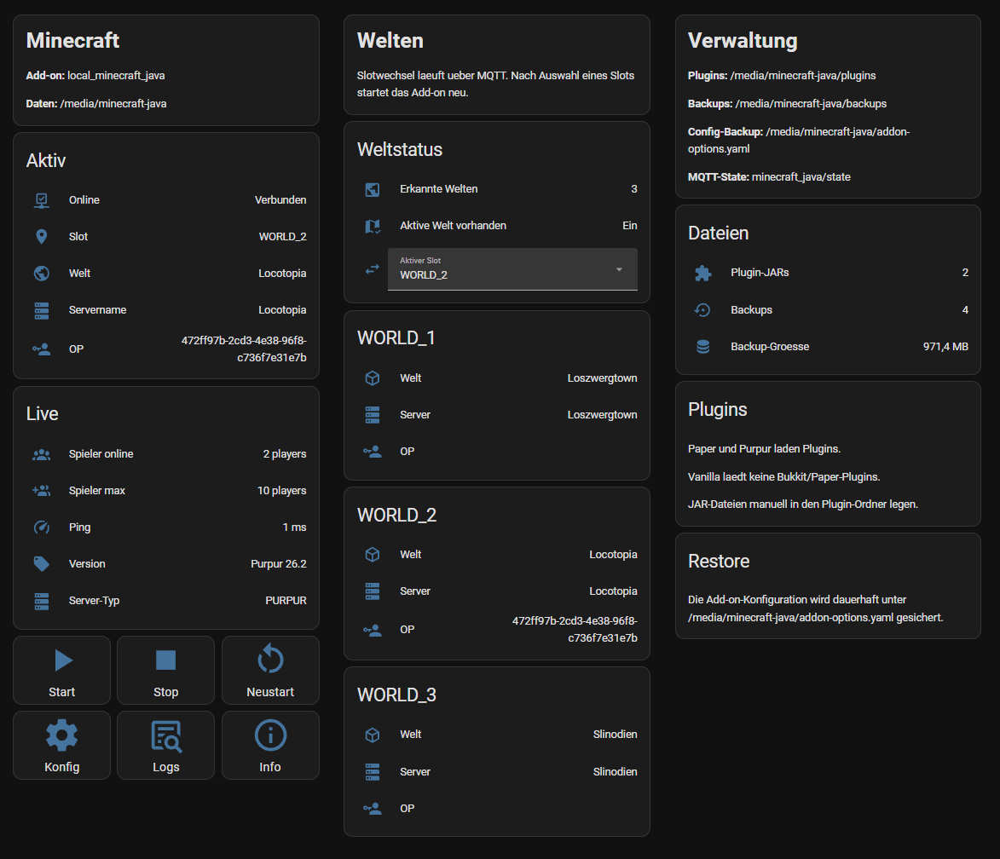

# Minecraft Java Server Home Assistant Add-on

This add-on runs a Minecraft Java server directly on Home Assistant OS. It uses the established `itzg/minecraft-server` image pinned to `2026.7.0` and stores all server data in `/media/minecraft-java`, so worlds, configuration, plugins, logs, and backups survive add-on restarts and updates and can be accessed through the Home Assistant media folder.

The default server type is Paper. Purpur and Vanilla are also supported through the add-on options.

The add-on uses `/media/minecraft-java/addon-options.yaml` as the persistent source of truth once that file exists. It also keeps a readable runtime copy at `/ha-addon-config/options.yaml`, exposed by Home Assistant OS below `/addon_configs/<addon-slug>/options.yaml`. This avoids mounting Home Assistant's main `/config` folder into the Minecraft image. On first start, the file is seeded from the Home Assistant add-on options. After that, Ingress and the controller read the media YAML and best-effort mirror it back to the Home Assistant add-on UI.

## Installation

1. In Home Assistant, open **Settings -> Add-ons -> Add-on Store -> Repositories**.
2. Add this repository URL.
3. Install **Minecraft Java Server**.
4. Open the add-on configuration, set `eula: true` only after reading and accepting the Minecraft EULA, then start the add-on.

## Example configuration

The visible default configuration is intentionally short. Advanced options such as ports, view distance, autopause, startup backups, Java flags, and recovery arguments remain available as optional add-on options, but are not shown by default in the Home Assistant form. After the first start, edit `/media/minecraft-java/addon-options.yaml` or use the Ingress admin panel; the add-on then mirrors that file back to the Home Assistant form when possible.

```yaml
eula: true
server_autostart: false
server_type: PAPER
minecraft_version: LATEST
memory_initial: 2G
memory_max: 6G
server_name: Familienserver
server_owner: "Spieler1"
motd: Willkommen auf unserem Minecraft-Server
world_slot: CUSTOM
world_1_name: world
world_1_server_name: ""
world_1_owner: ""
world_2_name: creative
world_2_server_name: ""
world_2_owner: ""
world_3_name: test
world_3_server_name: ""
world_3_owner: ""
level_name: world
allow_create_worlds: true
gamemode: survival
difficulty: normal
hardcore: false
pvp: true
online_mode: true
max_players: 10
block_disruptive_actions_when_players_online: true
enable_autopause: false
idle_shutdown_minutes: 30
view_distance: 10
simulation_distance: 8
spawn_protection: 0
white_list_enabled: true
whitelist: "Spieler1,Spieler2"
ops: ""
bedrock_enabled: false
bedrock_port: 19132
security_enabled: true
anti_xray_enabled: true
anti_xray_engine_mode: 2
anti_xray_manage_defaults: true
anti_xray_manage_nether: true
anti_xray_manage_end: false
grim_enabled: true
grim_auto_update: true
grim_auto_compatible_beta: true
grim_update_channel: stable
grim_punishments_managed: true
grim_public_alerts: true
grim_public_alert_threshold: 8
grim_public_alert_interval: 8
grim_kick_enabled: true
grim_kick_threshold: 15
grim_event_log_enabled: true
grim_event_log_max_entries: 500
xray_suspicion_enabled: true
xray_suspicion_alert_threshold: 120
xray_suspicion_window_minutes: 20
xray_suspicion_rcon_alerts: true
xray_suspicion_alert_cooldown_seconds: 300
xray_suspicion_rcon_save_before_scan: true
plugins_enabled: false
plugin_preset: MANUAL
modrinth_plugins: ""
plugin_urls: ""
plugin_browser_enabled: true
ingress_admin_password: ""
ingress_admin_users: ""
playit_enabled: false
playit_secret: ""
playit_public_address: ""
enable_rcon: true
rcon_password: "CHANGE_ME"
rcon_message_stop_announcement: true
rcon_message_stop_save: true
rcon_message_backup_save: true
enable_auto_backup: false
backup_on_shutdown: false
backup_on_world_switch: false
backup_on_start: false
backup_interval_hours: 6
backup_retention_days: 14
backup_min_interval_minutes: 30
backup_keep_last: 10
mqtt_enabled: false
mqtt_host: core-mosquitto
mqtt_port: 1883
mqtt_username: ""
mqtt_password: ""
```

Advanced optional values can be added manually when needed:

```yaml
view_distance: 10
simulation_distance: 8
backup_interval_hours: 6
backup_retention_days: 14
backup_min_interval_minutes: 30
backup_keep_last: 10
mqtt_enabled: true
mqtt_username: "minecraft"
mqtt_password: "CHANGE_ME"
enable_autopause: true
idle_shutdown_minutes: 30
extra_server_options: "--safeMode"
```

## Memory

The add-on always passes explicit heap limits to Java using `INIT_MEMORY` and `MAX_MEMORY`. It never tries to consume all free RAM automatically.

For an amd64 ThinkPad with 32 GB RAM and about 10 GB already used:

- Small server: `2G` to `4G`
- Normal family server: `4G` to `6G`
- Larger world or several plugins: start carefully with up to `8G`

Valid values look like `2G` or `4096M`. `memory_initial` must not be larger than `memory_max`.

## Server Types

`PAPER` is recommended for most family servers because it is compatible with many plugins and performs well. `PURPUR` adds more tuning options. `VANILLA` is closest to Mojang's official server and is the simplest choice if no plugins are needed.

`minecraft_version: LATEST` lets the base image install the latest supported Minecraft release at startup. Pin a version such as `1.21.7` if you want controlled upgrades.

Paper and Purpur can lag behind the newest Vanilla release. If your Minecraft client says "outdated server", pin `minecraft_version` to the version shown in the Paper log and start the client with that same version, or use `VANILLA` with a clean/separate world for the newest Mojang release.

Do not freely switch an existing Paper/Purpur world to Vanilla. Paper can add data packs and configuration that Vanilla does not understand. For testing Vanilla, use a different `level_name` such as `vanilla-test`, or move the existing world away first. If you intentionally need Vanilla recovery mode, set `extra_server_options: "--safeMode"` temporarily.

## Persistence, Plugins, and Restore

Persistent data is stored below `/media/minecraft-java`, including worlds, `server.properties`, `ops.json`, `whitelist.json`, `plugins`, `mods`, `logs`, and `backups`. Add-on updates do not overwrite an existing world. The wrapper links the Minecraft files expected by the underlying `itzg/minecraft-server` image from `/data` into the media folder while leaving Home Assistant's `/data/options.json` untouched.

The active add-on options are `/media/minecraft-java/addon-options.yaml` after it has been created. On first start, the add-on seeds that file from Home Assistant Supervisor options. On later starts, the media YAML wins and the add-on attempts to push those values back to Supervisor. It also writes `/ha-addon-config/options.yaml` as a convenience copy.

Install Paper or Purpur plugins by placing `.jar` files in `/media/minecraft-java/plugins` and restarting the Minecraft server from the dashboard. Restore a backup by stopping the add-on, unpacking the desired archive into `/media/minecraft-java`, and starting the add-on again.

On startup, the add-on checks that the configured `level_name` points to a real world folder with `level.dat`. If another world is found in `/media/minecraft-java` but the configured world name is empty or missing, startup stops with a clear error instead of silently creating a fresh world. Set `level_name` to the existing folder name, or restore/copy the wanted world into `/media/minecraft-java/<level_name>`.

For easier switching in the Home Assistant UI, configure up to three named world slots and choose the active one with `world_slot`:

```yaml
world_slot: WORLD_1
world_1_name: loszwergtown
world_1_server_name: Loszwerg Town
world_1_owner: NachoLoco
world_2_name: creative
world_2_server_name: Creative Baulabor
world_2_owner: CreativeBoss
world_3_name: redstone-test
world_3_server_name: Redstone Testwelt
world_3_owner: ""
level_name: loszwergtown
```

`CUSTOM` keeps the old behavior and starts the world from `level_name`. `WORLD_1`, `WORLD_2`, and `WORLD_3` start the matching `world_1_name`, `world_2_name`, or `world_3_name` folder below `/media/minecraft-java`.

Each world slot can also have its own owner. If `world_1_owner`, `world_2_owner`, or `world_3_owner` is set for the active slot, that player is added to `ops`. If the slot owner is empty, the global `server_owner` is used.

Each slot can also override the visible server name with `world_1_server_name`, `world_2_server_name`, or `world_3_server_name`. Empty slot names fall back to the global `server_name`.

World names are matched case-insensitively against existing media folders, so `Loszwergtown` will reuse `/media/minecraft-java/loszwergtown`. If `allow_create_worlds` is `true`, selecting a slot whose world folder does not exist yet creates a new world with that name. Set it to `false` if you prefer typo protection over quick world creation.

To protect active players, `block_disruptive_actions_when_players_online: true` blocks MQTT restart and world-slot switch commands while at least one player is online. The example dashboard also hides the restart and world switch controls while the player count is not `0`.

Set `enable_autopause: true` to stop the Minecraft server automatically after `idle_shutdown_minutes` with no online players. The add-on controller, MQTT controls, Ingress panel, and optional playit.gg agent stay running, so the server can be started again from Home Assistant.

If old data exists below `/data/minecraft` or `/hassio_data`, the add-on copies it once only when `/media/minecraft-java` is empty. It never deletes legacy data automatically.

If the wrapper finds a conflicting file in `/data` while the media copy already exists, it moves the `/data` copy into `/media/minecraft-java/migration-conflicts` and keeps the media folder authoritative.

Empty or invalid Minecraft JSON lists such as `ops.json` and `whitelist.json` are repaired to `[]` on startup. Invalid originals are kept next to the repaired file with an `.invalid-...` suffix.

Vanilla 26.2 and newer rejects symlinked world directories during its file-layout upgrade. For Vanilla, the add-on therefore runs the world from a real `/data` directory and synchronizes it back to `/media/minecraft-java` during backups and shutdown. Paper and Purpur can use direct media links for their world folders.

## Backups

Backups are compressed archives named with UTC date and time in `/media/minecraft-java/backups`. They exclude logs and existing backups to avoid recursive archives. When RCON is enabled, the add-on runs `save-all flush`, temporarily disables world saving, creates the archive through a temporary file, re-enables saving, and rotates old backups.

The Ingress Backup tab shows backup configuration, current backup count, total backup size, the latest backup, manual `Backup now`, and every existing `minecraft-*.tar.gz` archive. Manual backup runs are accepted even when `backup_min_interval_minutes` would skip scheduled or lifecycle backups. The selected world is recorded in the manual backup reason so the list stays understandable, but the archive remains a full Minecraft data backup.

`backup_retention_days` removes normal backups older than the configured age. `backup_keep_last` additionally keeps only the newest X normal backups; set it to `0` to disable the count limit.

`backup_min_interval_minutes` prevents backup storms during repeated restarts. The default `30` means a second backup within 30 minutes is skipped. `backup_on_world_switch` defaults to `false`, so fast MQTT world switches do not create shutdown backups. Scheduled backups and normal shutdown backups still work, but the cooldown keeps Home Assistant storage from being hammered.

Backups can be marked persistent from the Backup tab. A persistent backup gets a small `.persistent` sidecar file and is excluded from both age-based retention and `backup_keep_last` counting until the flag is removed or the backup is deleted manually. The Backup tab can also remove the persistent flag, delete backup archives, and request a full restore from any listed backup.

Restore is intentionally explicit. It is an admin action, asks for confirmation in the browser, stops the Minecraft process through the controller, extracts the selected archive into a temporary restore directory, and replaces the current Minecraft data folder contents except the `backups` directory itself.

## Whitelist and Operators

Use `server_owner` for the default owner account. For world slots, `world_1_owner`, `world_2_owner`, and `world_3_owner` can override it per world. The selected owner is automatically added to `ops`. Use `white_list_enabled`, `whitelist`, `ops`, and `enforce_whitelist` for additional access control. Keep player names comma-separated. `online_mode` defaults to `true` and should stay enabled for public servers.

## Plugins

Plugins are supported with `PAPER` and `PURPUR`. Vanilla does not load Bukkit/Paper plugins.

The most reliable install method is manual: copy plugin `.jar` files into `/media/minecraft-java/plugins` and restart the Minecraft server. This directory is persistent and is linked into the server's `/data/plugins`.

The add-on also includes a Home Assistant Ingress panel. It is split into Dashboard, Spieler, Security, Systemmessages, Backup, Plugins, Mods, and Admin tabs. The Dashboard shows server status, active world, start/stop/restart controls, guarded world switching, playit.gg status, and a read-only Security overview. The Systemmessages tab shows known RCON-generated messages and lets admins enable or disable stop announcements, stop saves, backup saves, Xray stats saves, and Xray suspicion alerts. The Backup tab handles backup configuration, manual backups, restore, persistent flags, and backup deletion. Plugins and Mods have separate JAR management tabs for `/media/minecraft-java/plugins` and `/media/minecraft-java/mods`. The panel is available to logged-in Home Assistant users, not only administrators.

The panel has two modes. User mode keeps start, stop, restart, world switching, player overview, Security overview, Systemmessages status, and JAR management available. Home Assistant admin users enter admin mode automatically only when Home Assistant forwards an admin header. If user headers are forwarded, `ingress_admin_users` can allow matching forwarded usernames, user IDs, or email addresses into admin mode without a password. If Home Assistant does not forward any user data to the add-on, use `ingress_admin_password` for admin mode. Admin mode exposes common server configuration, world-slot definitions, plugin automation, MQTT, playit.gg, backup settings, Security tuning, Systemmessages toggles, and reset actions. It writes configuration changes to `/media/minecraft-java/addon-options.yaml`, mirrors them to the runtime add-on config copy and local options JSON, and best-effort syncs them back to Supervisor options. The explorer can upload, download, and delete `.jar` files without exposing the whole media folder. Disable it with `plugin_browser_enabled: false` if you only want to manage plugins and mods through Samba, VS Code, or the terminal.

The Plugins tab inspects Bukkit/Paper `.jar` files for `plugin.yml` or `paper-plugin.yml`. If the internal plugin name contains characters Paper rejects, such as spaces, the table marks the JAR as invalid and admin mode can move it to `/media/minecraft-java/plugins-disabled` without deleting it.

The Spieler tab lists known players from Minecraft's local files and stats where available. It shows current online state, banned/offline/online status, last seen data, current Xray suspicion score, maximum stored Security score, related Security events, mined materials, mined blocks, and total online time where the server has recorded it. Player columns can be sorted, including by current or maximum score. Admin mode adds reset actions for a player's current Xray score and maximum stored score.

When RCON is enabled and `rcon_password` is set, the Security tab also shows moderation controls. It can kick online players, ban players, unban players from the persistent ban list, and display the current ban list next to the Security status.

## Bedrock Support

Optional Bedrock joining is controlled by one switch:

```yaml
bedrock_enabled: true
bedrock_port: 19132
```

The add-on statically publishes TCP `25565` for Java and UDP `19132` for Bedrock in `config.yaml`, because Home Assistant add-on ports cannot be added dynamically at runtime. `bedrock_port` configures the Geyser listener inside the add-on; keep the add-on port mapping aligned with it unless you intentionally change both.

When `bedrock_enabled` is true on a Paper or Purpur server, the controller prepares Geyser-Spigot and Floodgate before Minecraft starts. Existing jars in `/media/minecraft-java/plugins` are reused, missing jars are downloaded from the official GeyserMC download endpoints, and disabled jars are restored from `/media/minecraft-java/plugins-disabled`. Geyser is configured with `bedrock.address: 0.0.0.0`, the configured UDP port, and Floodgate authentication. Existing Geyser settings are preserved except for those required values, and the first existing `config.yml` is backed up as `config.yml.bak`.

When `bedrock_enabled` is false, the controller does not delete Geyser or Floodgate data. It only moves matching Geyser/Floodgate jar files from `/media/minecraft-java/plugins` to `/media/minecraft-java/plugins-disabled`, leaving plugin folders, cache data, resource packs, mappings, Floodgate config and `key.pem` in place for later reactivation.

Keep `online_mode: true`. Floodgate lets Bedrock players join without a Java account while Java players continue to authenticate normally with their Java accounts. Warnings about missing secure chat profiles for Floodgate players are not treated as fatal connection errors.

Phones, tablets, and Windows Bedrock clients can add the server directly with the Bedrock UDP port. Xbox, PlayStation, and Nintendo Switch do not allow arbitrary Bedrock server addresses in the normal UI. A local DNS server can redirect an official featured-server domain to the local Minecraft server IP, for example:

```text
mco.cubecraft.net -> 192.168.32.14
```

The add-on does not make DNS changes automatically. The exact domain can change with Minecraft versions and should be identified from your DNS query log.

Player counting uses the active Java/Purpur player list as the canonical source and uses Geyser/Floodgate logs only to mark platform and display names. Bedrock players are therefore not added on top of the server-reported total. Two Java players plus one Floodgate/Geyser Bedrock player are reported as `players_online: 3`, `players_java: 2`, and `players_bedrock: 1`.

The add-on also exposes optional automatic plugin helpers:

```yaml
plugin_preset: MANUAL
modrinth_plugins: ""
plugin_urls: ""
```

Use `MANUAL` when you manage `.jar` files yourself. Set `plugins_enabled: true` and use another preset only if you want the add-on to try automatic downloads:

```yaml
plugins_enabled: true
plugin_preset: TPA_ESSENTIALSX
modrinth_plugins: ""
plugin_urls: ""
```

Available presets:

- `NONE`: no preset.
- `TPA_ESSENTIALSX`: EssentialsX for `/tpa`, `/home`, `/spawn`, `/warp`.
- `PERMISSIONS_LUCKPERMS`: LuckPerms permission management.
- `BEDROCK_GEYSER`: Geyser and Floodgate for Bedrock clients.
- `VOICE_CHAT`: Simple Voice Chat.
- `MAP_BLUEMAP`: BlueMap web map plugin.
- `FAMILY_STARTER`: EssentialsX, LuckPerms, Geyser, and Floodgate.

For custom plugins, place `.jar` files in `/media/minecraft-java/plugins`, add Modrinth project slugs, or add direct jar/download URLs:

```yaml
plugins_enabled: true
plugin_preset: MANUAL
modrinth_plugins: |
  essentialsx
  luckperms
plugin_urls: |
  https://example.org/MyPlugin.jar
```

Only use plugin sources you trust. Plugins run inside the server process and can access server files. If an automatic download does not work for a plugin, download the `.jar` manually into `/media/minecraft-java/plugins`; that path is the intended fallback.

## Network and Security

The Minecraft port defaults to TCP `25565`. Forward that port only if you understand the risk of exposing a game server publicly. RCON is disabled by default, must have a non-empty password when enabled, and should not be exposed to the internet.

## Security Center

`security_enabled: true` enables the integrated Security Center for Paper and Purpur servers. It prepares Paper Anti-Xray before Minecraft starts, manages Grim AntiCheat as a normal plugin jar in `/media/minecraft-java/plugins`, and exposes Security status, Grim punishments and stored events in the Ingress panel.

Paper Anti-Xray obscures block data sent to clients. It is useful, but not perfect. Mode `2` is the recommended strong default; mode `1` is lighter, and mode `3` can make chunk data more network-friendly. The add-on updates only the managed Anti-Xray keys and keeps existing hidden/replacement block lists when they already exist. Before writing Paper world YAML, it creates a backup under `/media/minecraft-java/security/backups`.

Grim checks Java players server-side. It cannot control every visual-only client modification such as HUDs, chat rendering or some minimap behavior. Grim is downloaded from official Modrinth releases; `grim_update_channel: stable` is the default stable preference. For very new Paper/Purpur server versions, `grim_auto_compatible_beta: true` allows the add-on to choose a compatible preview build when the stable channel is behind and the available candidate declares support for the current runtime. Existing working jars are kept when downloads fail. Plugin changes need a Minecraft restart. If existing Grim YAML config files contain a datastore `serverName`, `server-name`, or `server_name` key, Security preparation aligns it with the active world/server label.

The Grim status is based on runtime evidence from the server log, not just on the jar being present. If Grim is discovered by Bukkit but PacketEvents fails, Grim cannot detect cheats reliably and the Security Center stays unhealthy. It also warns when ViaVersion has `fix-1_21-placement-rotation` enabled, because Grim reports that setting can cause false positives and bypasses.

Grim `punishments.yml` remains the source of truth. Ingress offers a category overview and YAML expert editor for `/media/minecraft-java/plugins/GrimAC/punishments.yml`; unknown categories, checks, negated checks and custom commands are preserved when editing the raw YAML. Commands use `threshold:interval command`, for example `8:8 tellraw @a ...` or `15:15 kick %player% ...`. The default policy avoids permanent bans and favors graduated alerts, public suspicion messages and optional kicks.

When Bedrock support is enabled with Geyser/Floodgate, Grim protects Java players only. Bedrock players are exempt from Grim checks for compatibility. This is shown as a warning in the Security Center; Paper Anti-Xray still applies to transmitted world data.

The Xray suspicion score is an evidence score, not proof that a client mod is installed. It polls Minecraft's per-player stats files below the active world, including `stats/*.json` and `players/stats/*.json`, scores new tracked ore and Ancient Debris deltas, keeps a rolling time window, and emits a `Cheatverdacht` Security event once the configured threshold is reached. Stats from inactive worlds are ignored. The Security Center can tune the time window, alert threshold, cooldown, series bonuses and per-material weights. If RCON is enabled and `xray_suspicion_rcon_alerts` is true, the add-on sends a server message such as `[Security] Cheatverdacht: <player> hat Xray-Score 120 erreicht (...)`. The message is cooldown-limited and the default action is observation, not an automatic ban.

The first stats scan only records a baseline so old mining history does not trigger an immediate alert. Later increases in `minecraft:mined` or `minecraft:mine_block` counters are scored automatically by the controller's runtime poll. Scores decrease naturally when observations age out of the configured rolling window. Because Minecraft may keep player stats in memory for a short time, `xray_suspicion_rcon_save_before_scan: true` lets the add-on run a cooldown-limited RCON `save-all` before scanning when RCON is configured. Block-break observations can still be posted to `POST /api/security/xray/observation` by an admin tool or future bridge plugin with JSON like `{"player":"Steve","block":"minecraft:diamond_ore","visible":false}`. The log fallback also understands structured lines from a future `HAMinecraftBridge` source in the form `[HAMinecraftBridge] {"type":"block_break",...}`.

A normal Cloudflare Tunnel for Home Assistant HTTPS services does not publish a native Minecraft Java TCP server as a normal web URL. Use classic port forwarding with DNS, a VPN such as Tailscale, a suitable TCP proxy, or Cloudflare Spectrum or another TCP-capable Cloudflare product depending on your plan.

## playit.gg Tunnel

The add-on can optionally run the official playit.gg agent next to the lightweight controller. This is useful when you want to expose the Minecraft TCP server without opening a router port.

Create a playit.gg agent secret in the playit setup flow, set it as `playit_secret`, and enable playit controls. The add-on passes the secret to the standalone playit agent through its `--secret` option:

```yaml
playit_enabled: true
playit_secret: "CHANGE_ME"
playit_public_address: "garden-reduce.gl.joinmc.link"
```

In the playit.gg dashboard, configure the tunnel target as Minecraft Java on `127.0.0.1:25565`. `playit_enabled` only enables the Ingress controls; the agent does not autostart with the add-on. Admin mode in the Ingress panel can start and restart the playit agent manually without restarting the add-on. User mode can see the playit status/address and stop the tunnel.

If the log says `tunnel_count=0` or `email_not_verified`, the add-on is already connected to playit.gg, but the playit account still needs a verified email and an active tunnel in the playit dashboard.

When the playit agent logs a public address such as a `*.ply.gg`, `*.playit.gg`, or `*.joinmc.link` endpoint, the Ingress panel shows it in the playit.gg card. If the agent does not log the address, set `playit_public_address` to the address from your playit.gg dashboard so User mode can still show it.

Do not expose RCON through playit.gg. Keep RCON bound to the local add-on network and use it only for the built-in admin actions.

## Home Assistant Integration

The add-on works without any Home Assistant Minecraft integration. For native Home Assistant entities without YAML helpers, enable MQTT Discovery:

```yaml
mqtt_enabled: true
mqtt_host: core-mosquitto
mqtt_port: 1883
mqtt_username: "minecraft"
mqtt_password: "CHANGE_ME"
```

This expects a reachable MQTT broker, usually the Mosquitto Broker add-on plus the Home Assistant MQTT integration. The exporter publishes retained discovery topics below `homeassistant/...` and state below `minecraft_java/state`. Home Assistant then creates entities such as `binary_sensor.minecraft_java_server_minecraft_server_online`, `sensor.minecraft_java_server_minecraft_players_online`, `sensor.minecraft_java_server_minecraft_latency`, `sensor.minecraft_java_server_minecraft_backup_count`, and `sensor.minecraft_java_server_minecraft_world_count`.

The MQTT exporter also creates `select.minecraft_java_server_minecraft_world_slot`. Changing this select to `CUSTOM`, `WORLD_1`, `WORLD_2`, or `WORLD_3` publishes a command to `minecraft_java/command/world_slot`; the always-on add-on controller stops the Minecraft process, applies the slot change, and starts the selected world again.

It also creates `button.minecraft_java_server_minecraft_start`, `button.minecraft_java_server_minecraft_stop`, and `button.minecraft_java_server_minecraft_restart`. These buttons publish MQTT commands and let non-admin dashboard users control only the Minecraft server process without directly calling Supervisor services.

The add-on container now stays running as a lightweight controller. `server_autostart: false` keeps Minecraft idle after add-on startup until the MQTT start button is pressed. Set `server_autostart: true` only if the Minecraft server should boot immediately with the add-on.

The example dashboard is available at `dashboards/minecraft-dashboard.yaml`. Its control buttons publish directly to `minecraft_java/command/start`, `minecraft_java/command/stop`, and `minecraft_java/command/restart`, so they also work if Home Assistant has not refreshed the MQTT button entities yet.



Home Assistant automations can press the MQTT buttons or change the MQTT world-slot select. Keep the add-on itself running if you want non-admin users to start the Minecraft server from the dashboard.

## Known Limitations

Idle shutdown stops the Minecraft server process after the configured no-player timeout while the add-on controller remains available for MQTT and Ingress start commands. It does not implement wake-on-connect, because that requires a reliable proxy in front of the server.
